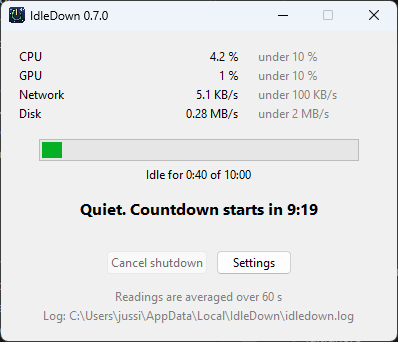
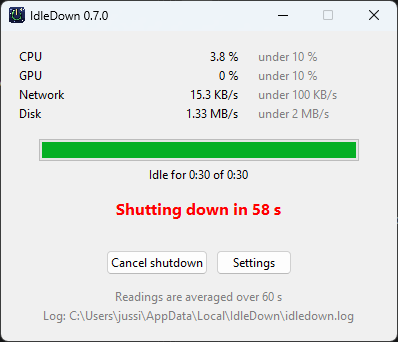

<p align="center">
  
</p>

<h1 align="center">IdleDown</h1>

<p align="center">
  Shuts your PC down once the long job it was running has actually finished.
</p>

<p align="center">
  <a href="https://github.com/JUSSI-G/IdleDown/releases/latest"><b>Download for Windows</b></a>
  ·
  <a href="#how-it-works">How it works</a>
  ·
  <a href="#running-from-source">Run from source</a>
</p>

<p align="center">
  
  &nbsp;
  
</p>

## Why I made this

I kept ending up in the same situation: the PC had to stay on for something long, like a big game download, an ML training run or a video render, and I didn't want to babysit it until the end. I also didn't want it running all night after the job was done.

The usual tricks didn't fit. A shutdown timer means guessing how long the job will take, and guessing wrong either kills the job or wastes hours. Sleep settings mostly go by whether someone is using the mouse and keyboard, not by whether a job is still running, and sleeping isn't the same as shutting down.

So I wrote IdleDown. It watches what the PC is actually doing, and when everything has been quiet for long enough, it shuts down.

## How it works

Every few seconds IdleDown reads four things:

- **CPU** usage
- **GPU** usage (NVIDIA cards; skipped if there isn't one)
- **Network** speed
- **Disk** speed

Each one has a limit. When all four stay under their limits for the whole idle time (10 minutes by default), a 60-second countdown starts. The window comes to the front and you can cancel. If nobody does, the PC shuts down.

A few details make this work with real jobs:

- **Activity above limiot resets the idle timer**, so a short pause between downloaded files, or Steam switching from downloading to unpacking, doesn't count as finished.
- **Readings are averaged over the last minute**, so brief background spikes, like Windows writing to disk every minute or two, don't keep resetting it.
- **The window tells you why the PC counts as busy**, for example "Busy: Disk is over its limit", and shows that value in orange.

> [!WARNING]
> On Windows the shutdown is forced (`shutdown /s /f`), because Windows refuses a normal shutdown while the screen is locked. Open apps are closed without asking, so save your work before leaving IdleDown running.

## Download (Windows)

Get `IdleDown-Setup-<version>.exe` from the [latest release](https://github.com/JUSSI-G/IdleDown/releases/latest) and run it.

- It installs for your user only, so no admin rights are needed.
- It adds a Start menu shortcut, and optionally a desktop one.
- Uninstall it from **Settings → Apps → Installed apps**.

The installer isn't digitally signed, so Windows may say "Windows protected your PC". Click **More info → Run anyway**.

## Fitting it to your PC

Every PC has its own "quiet" level, and the defaults won't suit all of them. Open **Settings** in the window to change any limit or timing. Your settings are saved and used every time IdleDown starts.

The settings window has two helpers:

- **Measure my idle PC** watches your PC for two minutes while you leave it alone, then fills in limits that fit it. It never suggests limits stricter than the defaults, and it tells you if the PC wasn't quiet enough to measure.
- **Check my running job** watches the job you're about to leave running for two minutes and tells you how reliably IdleDown sees it as busy. Green means it's clearly above the limits. Orange means it's close to them or sometimes dips below, so a quiet moment could look like the end of the job. Red means IdleDown doesn't see the job at all. The check only warns; it never changes your limits.

A job can have quieter phases than the two minutes the check saw, such as evaluation between training epochs. If you get an orange result, don't rely on IdleDown for that job.

## Platform support

IdleDown is built and tested on **Windows 11**, and the installer is Windows only. Windows 10 should work too, but I haven't tried it.

The code also has shutdown commands and settings folders for macOS and Linux, so it may run from source there, but I haven't tested it. On Linux, `systemctl poweroff` may need extra permissions.

## Running from source

You need Python 3.10 or newer. I develop and test with Python 3.12.

```powershell
git clone https://github.com/JUSSI-G/IdleDown.git
cd IdleDown
python -m venv .venv
.venv\Scripts\Activate.ps1
pip install -r requirements.txt
python main.py
```

If PowerShell says running scripts is disabled, allow local scripts once with `Set-ExecutionPolicy -Scope CurrentUser RemoteSigned` and try again.

Useful options:

```powershell
python main.py --help                          # all options and their current values
python main.py --dry-run                       # never shuts down, only logs what it would do
python main.py --console                       # no window, prints to the terminal instead
python main.py --idle-minutes 20 --cpu-limit 15
```

Command-line options override the saved settings for that run. If you then press Save in the settings window, the values in use, including those options, are saved.

### Where the log and settings are kept

IdleDown keeps a timestamped log, `idledown.log`, and your saved settings, `settings.json`, in a per-user folder:

| OS | Folder |
|---|---|
| Windows | `%LOCALAPPDATA%\IdleDown` |
| macOS | `~/Library/Application Support/IdleDown` |
| Linux | `~/.local/state/IdleDown` |

The window shows the exact log path, and `--log-file` changes it. If IdleDown ever does something unexpected, the log says what it measured and why.

## Development

### Tests

```powershell
python -m unittest discover -s tests -v
```

The tests cover the measuring logic: averaging, the idle timer, settings validation and the saved settings file, and both measurement helpers. They run on GitHub Actions for every push and pull request.

### Building the exe and installer

```powershell
.\build.ps1             # builds dist\IdleDown.exe
```

For the installer, install [Inno Setup](https://jrsoftware.org/isinfo.php) once with `winget install --id JRSoftware.InnoSetup.7 -e`, then:

```powershell
.\build-installer.ps1   # builds the exe, then installer-output\IdleDown-Setup-<version>.exe
```

### Releasing a new version

1. Change the number in `version.py`, for example to `0.8.0`, and commit it.
2. Tag the commit and push the tag:
   ```powershell
   git tag v0.8.0
   git push origin v0.8.0
   ```
3. GitHub Actions (`.github/workflows/release.yml`) runs the tests, builds the installer and publishes it as a new release. The tag must match `version.py`, or the build stops.

### Project layout

| File | What it does |
|---|---|
| `main.py` | Starts the app: reads settings, sets up logging, opens the window or console mode |
| `monitor.py` | Reads usage, averages it, tracks idle time, shuts down |
| `settings.py` | Settings: defaults, validation, the saved settings file and command-line options |
| `gui_app.py` | The main window |
| `settings_window.py` | The settings window |
| `calibration.py` | Measures an idle PC and suggests limits, or checks a running job |
| `console_app.py` | Terminal mode |
| `platform_utils.py` | Everything OS-specific: the shutdown command, the GPU and the settings folder |
| `version.py` | The version number |
| `tests/` | Unit tests |
| `installer.iss` | The Inno Setup installer script |
| `build.ps1`, `build-installer.ps1` | Build the exe, and the exe plus the installer |
| `.github/workflows/` | Tests on every push, and a release build when a version tag is pushed |
| `assets/` | The app icon (`IdleDown.ico` for Windows, `IdleDown.png` for the window) |
| `tools/make_icon.py` | Draws the pixel-art icon. Run `pip install pillow`, then `python tools/make_icon.py` |

## License

IdleDown is released under the [MIT License](LICENSE).

The Windows exe bundles Python, Tcl/Tk, [psutil](https://github.com/giampaolo/psutil) and [nvidia-ml-py](https://pypi.org/project/nvidia-ml-py/), each under its own open-source license. Their license texts are in [THIRD-PARTY-NOTICES.txt](THIRD-PARTY-NOTICES.txt), which the installer also places next to the exe.
